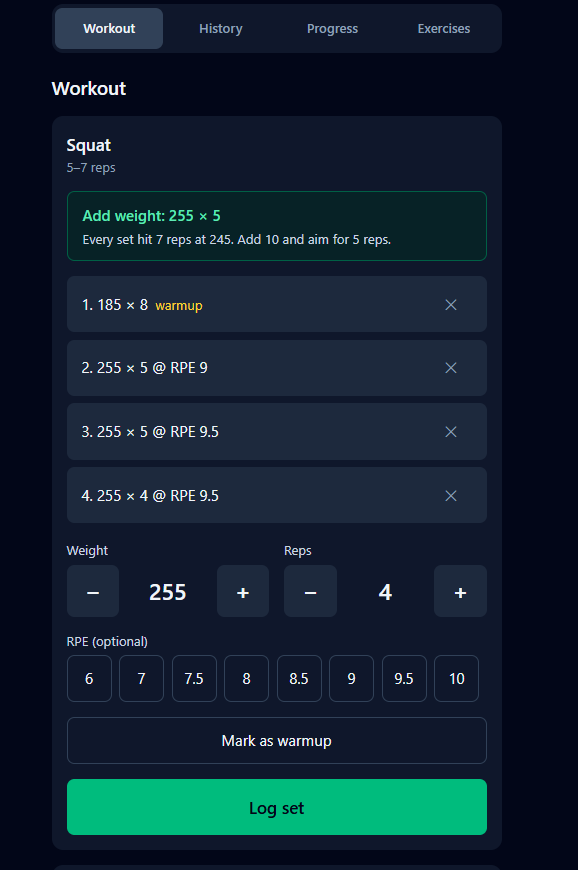
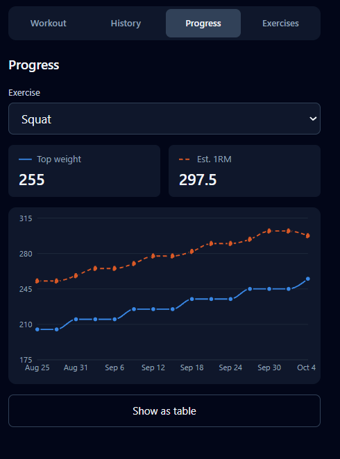

# ProLog

A mobile-first workout logger that tells you what to do next session. Log your sets, and ProLog uses your history to recommend whether to **add weight**, **stay and add reps**, or **deload**, with a plain-English reason every time.

**Live app:** [pro-log-mu.vercel.app](https://pro-log-mu.vercel.app). Tap **Try the demo** to explore with a few weeks of sample workouts; no sign-up needed.

<p>
  
  &nbsp;
  
</p>

## Features

- **Recommendations for every exercise**, based on double progression (rules below)
- **Progress Coach**: an optional AI-written report on your trends, plateaus and notes, built on facts the app calculates itself (details below)
- **Fast logging at the gym**: large +/- steppers for weight and reps (or tap the number to type it), optional RPE, warmup sets
- **Survives a locked phone**: an in-progress workout resumes after a reload
- **History**: past workouts with notes and sets grouped by exercise, editable and deletable
- **Progress charts**: top weight and estimated one-rep max over time, with a table view
- **Private by design**: each user can only ever read or change their own data, enforced in the database
- **One-tap demo**: visitors get their own temporary account, pre-filled with sample training

## How recommendations work

ProLog uses **double progression**: keep the weight fixed and work up through a rep range, then add weight and start again at the bottom of the range. Each exercise has a rep range (for example 8–12) and a weight increment (for example 2.5).

Only **working sets at the session's top weight** count. Warmups and lighter back-off sets are ignored.

| Situation | Recommendation |
|---|---|
| Every set reached the top of the rep range, and no set was RPE 9.5 or higher | **Add weight**: add the increment, aim for the bottom of the range |
| Fell short of the bottom of the range **this session and the previous one** at the same weight | **Deload**: drop about 10% (rounded to the increment, at least one increment), aim for the bottom of the range |
| Anything else | **Same weight**: aim for one more rep than your weakest set (capped at the top of the range) |
| No working sets logged yet | No recommendation; log a first session |

Two details that matter in practice:
- **A missing RPE never blocks an increase.** Not logging RPE is treated as "not too hard".
- **The current workout is excluded** when calculating, so the target doesn't shift while you're mid-session.

The rules live in [`src/domain/progression.ts`](src/domain/progression.ts) as a pure function with no React or database code, and are covered by unit tests.

## Progress Coach

At the top of the Progress tab you can ask an AI coach for a short written report. You choose what it covers (overall summary, exercise trends, plateaus, notes and recovery), the time range (4, 8 or 12 weeks), and which exercises to include. Reports are saved, so you can reread past ones.

**The AI explains; it never decides.** What to lift next session always comes from the rule-based engine above. The coach is given those decisions and told never to contradict them, so the numbers you train with stay predictable and tested.

**Code does the maths, the model does the writing.** Language models are unreliable at arithmetic over raw data but good at explaining numbers they're given. So before anything is sent, [`src/domain/coach.ts`](src/domain/coach.ts) calculates the facts:

- rate of progress per week (estimated 1RM), with lifts ranked fastest to slowest
- weight increases, sessions at the current weight, and sessions since each lift's best
- plateaus: the last 3 sessions didn't beat the earlier best
- how many reps each lift is from its next weight increase, and recent RPE
- training frequency, the longest gap, and days since the last workout
- for each workout note, how that day's lifts compared with their previous session, so "slept badly" can be linked to the numbers

The model only receives these facts and is told not to use any other numbers. Like the rest of `domain/`, this is pure, unit-tested code.

**How a report is made:**

1. The browser calculates the facts from your history.
2. It sends them to a Supabase Edge Function, which holds the OpenAI key on the server.
3. The function identifies the user from their verified sign-in token, validates the request, and reserves a report in the database. That's where the daily limits are enforced.
4. It calls OpenAI with Structured Outputs, so the reply must match a JSON schema, and checks the reply anyway. Section titles come from the app's code, not the model.
5. The report is saved and shown as plain text.

**Cost is capped in several places:** 2 reports per user and 8 across all users per day, a limit on the size of the facts sent and on the length of the reply, and a monthly budget set in OpenAI. Even at the daily maximum it costs about a cent a day.

**Privacy and safety:** workout notes are only sent if you choose the notes topic. The coach is told it isn't a medical professional, to suggest seeing one if notes mention pain, and to treat everything you've typed (exercise names, notes) as data rather than instructions.

## Tech stack

| Area | Choice |
|---|---|
| Frontend | React 19, TypeScript (strict), Vite |
| Styling | Tailwind CSS v4 |
| Backend | Supabase: Postgres, Auth, Row Level Security |
| Charts | Recharts (lazy-loaded, see below) |
| AI | OpenAI, called from a Supabase Edge Function (Deno) |
| Testing | Vitest, React Testing Library |
| Hosting | Vercel (free tier) |

Hosting costs nothing: Supabase's free tier and a static frontend, with no server to run. The only server-side code is one Edge Function, which exists because the OpenAI key must never reach the browser. The coach is the only paid part, and it's capped (see above).

## Architecture

```
src/
  lib/supabase.ts   Supabase client; fails fast with a clear error if env vars are missing
  types/            Database types generated by the Supabase CLI
  api/              Typed data-access functions: the ONLY code that talks to Supabase
  domain/           Pure logic: progression rules, coach facts, history grouping, 1RM estimates
  features/         One folder per screen: auth, workout, history, progress, exercises
  components/       Shared UI: Stepper, SetForm, ErrorWithRetry
supabase/
  migrations/       SQL schema, constraints and RLS policies, version-controlled
  functions/coach/  Edge Function: index.ts (server wiring) and report.ts (pure prompt and reply checks)
```

- **Screens never call Supabase directly.** They go through `api/`, which converts database rows (`rep_min`) to app types (`repMin`). Component tests mock one `api/` module instead of the database client.
- **`domain/` is pure TypeScript**, so the logic that matters most is tested without mocks.

## Security model

The browser talks to Postgres directly through Supabase, using a **public anon key** that ships in the JavaScript bundle. That key is not a secret, and doesn't need to be: **Row Level Security** is what protects the data.

- **Every table has a `user_id` column and RLS enabled.** The workout tables each have four policies (select, insert, update, delete), all of the form `auth.uid() = user_id`. Signed-out visitors match no policy and see nothing.
- **Coach reports are read-only for users.** `coach_reports` has a select-own policy and deliberately nothing else: only the Edge Function writes. If users could insert, they could skip the daily limits; if they could delete, they could free up a slot.
- **`user_id` defaults to `auth.uid()`** in the database, so the client never sends it. The insert and update policies also reject any attempt to set it to someone else's id.
- **Database constraints back up the UI's validation**: positive reps, non-negative weight, RPE between 6 and 10, a minimum rep count no higher than the maximum, and unique exercise names per user. Bad data is rejected even if someone bypasses the UI.
- **Deletes cascade**: deleting a workout removes its sets, and deleting an account removes everything the account owns.
- The **service-role key**, which bypasses RLS, is never used in frontend code. Only the coach Edge Function uses it, on the server, to write reports.
- **The OpenAI key is a Supabase secret**, read only inside the Edge Function. It never appears in `.env.local` or the browser bundle.
- **No one can spend another user's allowance.** The function that reserves a report takes a user id, so it can only be called with the service-role key, and the Edge Function takes that id from the caller's verified token, never from the request body.
- **Demo visitors are isolated too.** "Try the demo" uses Supabase anonymous sign-in, so each visitor is a separate user with their own rows, under the same policies. A database trigger seeds the sample data when the anonymous user is created, in the same transaction, so it exists before the app loads its first screen. The trigger function can't be called from the browser, and real sign-ups are never seeded.

The policies were checked against a local Postgres by signing in as two users and confirming that neither could read, change or delete the other's rows. The coach's limits and permissions were checked the same way: a third report in a day is refused, the ninth across all users is refused, and a signed-in user can't reserve, insert, edit or delete reports. The full schema is in [`supabase/migrations/`](supabase/migrations/).

## Data model

```
exercises  id, user_id, name, rep_min, rep_max, increment
workouts   id, user_id, performed_at, notes
sets       id, user_id, workout_id → workouts, exercise_id → exercises,
           set_order, reps, weight, rpe (nullable, 6–10), is_warmup
coach_reports  id, user_id, topics, period_weeks,
               status (pending / complete / failed), sections (jsonb), created_at
```

Weights are stored as `numeric` rather than floating point, so values like 2.5 or 1.25 are exact.

## Design decisions

- **The active workout is remembered on the device.** Phone browsers often reload a tab after the screen locks. Sets are saved to the database as they're logged, and the workout's id is kept in `localStorage` so it resumes. A workout more than 6 hours old isn't resumed, so a forgotten "Finish" doesn't put next week's sets on an old date.
- **Concurrent saves can't overwrite each other.** State updates are computed from the latest state (`setState(current => …)`), so two sets saved at nearly the same time are both kept.
- **History is one request per page.** A single nested query fetches workouts, their sets and exercise names together, and paging uses an offset rather than a page number so it stays correct after a workout is deleted.
- **The chart library is lazy-loaded.** Recharts nearly doubled the bundle, so the Progress tab is loaded on first visit. The initial download stays around 130 kB gzipped, and the Workout screen never waits for chart code.
- **Accessible charts.** The two series use colors checked for color-vision deficiency and contrast against the dark background, one line is dashed so color isn't the only difference, the chart has a text summary for screen readers, and every chart has a table view.
- **Steppers you can also type into.** +/- buttons are best for the usual small change mid-set, but going from 205 to 315 would take 22 taps. Tapping the number opens a numeric keypad. Typed text is only applied when you finish, so a half-typed "10" on the way to "102.5" is never saved, and invalid input goes back to the previous value.
- **The coach's daily limits are enforced in the database.** "Count today's reports, then insert" is two steps, so two requests arriving together could both see "1 of 2 used". A Postgres function takes a lock, counts and inserts in one transaction, so requests take turns.
- **Failed coach attempts still count toward the limit.** A call can fail after OpenAI has replied (for example, an unreadable reply), and that still costs money. A limit that refunded failures wouldn't really limit spending.
- **The AI model is a setting, not code.** It's stored as a secret next to the API key, so it can be changed without redeploying.

## Testing

205 tests across the domain logic, the coach's Edge Function, shared components and every screen.

- **Domain**: every progression rule and edge case (RPE blocking an increase, missing RPE, warmups ignored, deload rounding), history grouping, 1RM estimates, and every coach fact (rates, plateaus, frequency, note context).
- **Edge Function**: request validation and checks on the model's reply (missing, extra or repeated sections; replies that aren't JSON). This logic lives in a pure `report.ts`, so Vitest tests it and the app's TypeScript build type-checks it.
- **Screens**: loading, empty and error states, plus the main user flows, with the `api/` layer mocked.

```
npm run test     # run all tests
npm run lint     # ESLint
npm run build    # type-check and production build
```

## Running locally

Requires Node.js 22.12 or later, and a Supabase project (the free tier is enough).

1. Install dependencies:
   ```
   npm install
   ```
2. Copy `.env.example` to `.env.local` and fill in your project's URL and anon key (Supabase dashboard → Project Settings → API).
3. Apply the schema to your project:
   ```
   npx supabase login
   npx supabase link
   npx supabase db push
   ```
4. Start the dev server:
   ```
   npm run dev
   ```
5. Optional, for the Progress Coach: set the OpenAI secrets and deploy the function. Use a model that supports Structured Outputs, and set a monthly budget in your OpenAI project.
   ```
   npx supabase secrets set OPENAI_API_KEY=sk-... OPENAI_MODEL=<model-id>
   npx supabase functions deploy coach
   ```

To work fully offline with Docker installed, `npx supabase start` runs a local Supabase stack with the same migrations. To try the coach locally, put the two secrets in an env file outside the repo and run `npx supabase functions serve coach --env-file <path>`.
